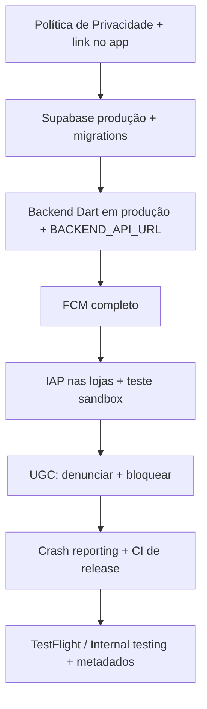

# Aluga Comigo — Checklist para publicação nas lojas

Relatório de readiness para **Google Play** e **App Store**, com base no estado do repositório em outubro/2026.

**Escopo:** `mobile/aluga_comigo`  
**Versão referência:** ver `version` em [`pubspec.yaml`](../../pubspec.yaml) (ex.: `1.0.1+2`)

---

## Resumo executivo

O produto está em estágio **MVP+**: swipe/match, chat, curtidas, multi-anúncio, loja in-app, missões, tickets de suporte, termos com reaceite, exclusão de conta e integração planejada com FCM. A arquitetura (Clean Architecture + Supabase + API Dart) está madura para evoluir.

O que mais atrasa uma publicação “redonda” **não é** uma feature central ausente, e sim:

1. **Camada legal** (Política de Privacidade publicada e acessível no app)
2. **Infraestrutura de produção** (Supabase hosted, backend Dart 24/7, FCM completo)
3. **Monetização operacional** (produtos IAP configurados e testados nas lojas)
4. **Requisitos de UGC** (denunciar/bloquear — especialmente Apple)
5. **Release engineering** (CI, crash reporting, testes além de E2E)

---

## O que já existe (baseline)

### Produto

| Área | Status | Referência no código / docs |
|------|--------|-----------------------------|
| Contas pessoa e imóvel | ✅ | Módulo `auth` |
| Feed swipe + match | ✅ | `customer`, `house` |
| Chat + ofertas de imóvel | ✅ | `chats` |
| Curtidas / histórico / Super Star | ✅ | `like` |
| Vários anúncios por conta imóvel | ✅ | `my_immobiles` |
| Loja (Super Star, Super Chat, PowerUp) | ✅ | `store`, catálogo em `store_catalog.dart` |
| Missões | ✅ | `quest` |
| Notificações in-app | ✅ | `notifications` |
| Tickets / suporte | ✅ | `tickets` (menu em `start_page`) |
| Termos de uso v1.0 + aceite | ✅ | `assets/legal/`, `terms_acceptance_flow.dart` |
| Esconder / apagar conta | ✅ | `security_page.dart` |
| Modo manutenção (app + backend) | ✅ | `splash_page.dart`, `system_config` |

### Plataforma e backend

| Área | Status | Referência |
|------|--------|------------|
| Migrations Supabase (001–027) | ✅ | `supabase/migrations/` |
| API Dart (loja, inventário, missões) | ✅ | `backend/`, [`backend/README.md`](../../backend/README.md) |
| Documentação FCM | ✅ | [`docs/fcm-setup.md`](../fcm-setup.md) |
| Defines de ambiente (sem secrets no Git) | ✅ | `dart_defines*.json` gitignored, `env_config.dart` |
| Ícones de launcher | ✅ | `flutter_launcher_icons` no `pubspec.yaml` |
| Testes E2E Patrol | ✅ | `patrol_test/` (4 jornadas) |

### Pendências já reconhecidas no README

- CI/CD e deploy do backend dedicado
- Migração total do client Supabase → API (fase posterior)

---

## Bloqueadores ou quase bloqueadores

### 1. Legal e LGPD

**Situação**

- Termos de Uso existem e há fluxo de aceite no cadastro e após login (nova versão).
- Os termos **referenciam** Política de Privacidade, mas **não há** documento equivalente em `assets/legal/` nem tela dedicada no app (apenas [`terms_of_use_page.dart`](../../lib/app/shared/presenter/pages/terms_of_use_page.dart)).

**O que fazer**

- [ ] Redigir **Política de Privacidade** (LGPD): controlador, bases legais, finalidades, dados coletados (perfil, fotos, localização, chat, compras), compartilhamento (Supabase, Firebase, lojas), retenção, direitos do titular, canal de contato / encarregado (DPO) se aplicável.
- [ ] Publicar em **URL estável** (site ou página hospedada) — obrigatório nas fichas Play/App Store.
- [ ] Incluir asset em `assets/legal/` (espelhar fluxo dos termos) e telas/links: cadastro, configurações, loja (compras).
- [ ] Alinhar texto dos Termos com a política (versão e data).

**Referências**

- Termos atuais: [`assets/legal/termos-de-uso-v1.0.md`](../../assets/legal/termos-de-uso-v1.0.md)
- Seção LGPD nos termos: §11

---

### 2. Produção (Supabase + backend Dart)

**Situação**

- O splash **impede uso** se o backend Dart não responder (`_ensureBackendHealthy` em [`splash_page.dart`](../../lib/app/modules/intro/ui/splash_page.dart)).
- Em dev, `BACKEND_API_URL` aponta para `127.0.0.1:8080` ([`backend_config.dart`](../../lib/backend_config.dart)).
- [`dart_defines.example.json`](../../dart_defines.example.json) **não lista** `BACKEND_API_URL` nem variáveis Firebase — risco de release incompleto.

**O que fazer**

- [ ] Projeto **Supabase hosted**: aplicar todas as migrations (`supabase db push` ou pipeline).
- [ ] Revisar **RLS** e Storage em ambiente real (não confiar só no client).
- [ ] **Deploy** da API Dart (`backend/`) com HTTPS, health em `/health`, variáveis `DATABASE_URL`, `SUPABASE_JWT_SECRET`, `PORT`.
- [ ] Definir `BACKEND_API_URL` de produção no `--dart-define-from-file` de release.
- [ ] Monitoramento (uptime, logs, alertas) — queda do backend = app inteiro em “manutenção”.
- [ ] Documentar runbook de deploy (app + backend + Edge Functions).

**Referências**

- Rotas API: [`backend/README.md`](../../backend/README.md)
- Script local: `scripts/runBackend.sh`, `scripts/initDev.sh`

---

### 3. Compras in-app (IAP)

**Situação**

- Implementação com `in_app_purchase` e catálogo fixo (`super_star_*`, `super_chat_*`, `power_up_*`) em [`store_catalog.dart`](../../lib/app/modules/store/interactor/models/store_catalog.dart).
- Fulfillment via backend: `POST /v1/purchases/fulfill` → RPC `fulfill_purchase`.

**O que fazer**

- [ ] Criar **mesmos product IDs** na Play Console e App Store Connect.
- [ ] Alinhar **preços** exibidos no app com preços reais das lojas (ou buscar preço da loja na UI).
- [ ] Testar fluxo completo: compra sandbox → fulfill → inventário no app.
- [ ] Política de reembolso / texto legal na loja in-app (CDC + regras das lojas).
- [ ] Apple: **Restaurar compras** quando aplicável ao tipo de produto consumível/não consumível (validar guidelines atuais).
- [ ] Conta de desenvolvedor, contratos fiscais e banking configurados em ambas as lojas.

---

### 4. Conteúdo gerado por usuários (UGC)

**Situação**

- App com fotos, perfis e chat — enquadramento próximo a apps sociais / discovery.
- Existe categoria `report` em tickets ([`ticket_category.dart`](../../lib/app/modules/tickets/domain/enums/ticket_category.dart)), mas **não** há fluxo óbvio “denunciar perfil/chat” no contexto do match.
- **Bloqueio** de usuário não aparece em migrations ou módulos dedicados.

**O que fazer**

- [ ] **Denunciar** perfil, anúncio ou conversa (atalho na UI + ticket ou RPC dedicada).
- [ ] **Bloquear** usuário (some do feed, impede chat; persistir no Postgres + RLS).
- [ ] Descrever moderação nos Termos (prazos, medidas) e e-mail de contato visível.
- [ ] Processo operacional inicial (triagem de tickets categoria Denúncia).

**Nota:** Apple costuma exigir mecanismos de UGC explícitos antes de aprovar apps com interação entre usuários.

---

### 5. Push (FCM) em produção

**Situação**

- Firebase só inicializa se defines estiverem configurados ([`firebase_config.dart`](../../lib/firebase_config.dart)).
- Arquivos nativos estão gitignored (correto): `google-services.json`, `GoogleService-Info.plist`.
- Pipeline documentado em [`docs/fcm-setup.md`](../fcm-setup.md) (migration 021, Edge Function `send-chat-push`, secrets).

**O que fazer**

- [ ] Firebase project + apps Android/iOS com bundle/package `com.fluttercraft.alugaComigo`.
- [ ] Defines Flutter: `FIREBASE_PROJECT_ID`, `FIREBASE_API_KEY`, `FIREBASE_APP_ID`, `FIREBASE_MESSAGING_SENDER_ID`, etc.
- [ ] Aplicar migration `022_device_push_tokens_fcm.sql` (e dependências) no hosted.
- [ ] Deploy da Edge Function + secrets + database settings (`push_webhook_secret`, URL Supabase).
- [ ] Testar: app em background/fechado → mensagem de chat → notificação nativa → deep link para conversa.

---

## Segurança e confiança (recomendado antes de escala)

| Tópico | Situação | Ação sugerida |
|--------|----------|----------------|
| Auto-login com senha persistida | `LoginUser` grava `UserModel` (incl. **password**) em secure storage; splash reloga com credenciais | Migrar para **sessão Supabase** (refresh token); não persistir senha |
| `freerasp` no `pubspec.yaml` | Dependência presente; bootstrap não inicializa RASP | Integrar em release ou remover dependência não usada |
| Verificação de e-mail | Seed usa `email_confirmed_at`; app sem fluxo “confirme seu e-mail” | Definir política Auth (obrigatório ou não) + UI de reenvio |
| Observabilidade | Sem Crashlytics / Sentry / analytics | Adicionar crash reporting e métricas mínimas (login, compra, match) |
| Secrets | Defines via arquivo local | Pipeline de release com secrets em CI (não commitar) |

**Arquivos relevantes**

- [`login_user.dart`](../../lib/app/modules/auth/domain/usecases/login_user.dart)
- [`splash_page.dart`](../../lib/app/modules/intro/ui/splash_page.dart)
- [`app_bootstrap.dart`](../../lib/app/app_bootstrap.dart)

---

## Qualidade e release engineering

### Testes

| Tipo | Situação | Ação |
|------|----------|------|
| Unit / widget (`test/`) | Pasta citada no README **não existe** no repo | Criar espelho `test/app/modules/`; priorizar auth, store, use cases críticos |
| E2E Patrol | 4 testes em `patrol_test/` | Manter na pipeline de release candidate |
| `dart analyze` / format | Documentado em AGENTS.md | Automatizar no CI |

### Builds

- [ ] Android: `flutter build appbundle --release` com `key.properties` e Play App Signing.
- [ ] iOS: archive + TestFlight; certificados e provisioning profiles.
- [ ] Validar **orientação**: app fixa portrait em [`app_bootstrap.dart`](../../lib/app/app_bootstrap.dart); revisar `Info.plist` (landscape listado — alinhar se necessário).
- [ ] iOS: Privacy Manifest, capabilities (Push, In-App Purchase).

### CI/CD

- [ ] Pipeline: analyze → test → build (opcional artifact).
- [ ] Deploy backend + `supabase functions deploy` + migrations em staging antes de prod.
- [ ] Versionamento: bump `version` em `pubspec.yaml` a cada release (`name+build`).

---

## Metadados e presença nas lojas

Itens **fora do código**, necessários na submissão:

- [ ] Nome, subtítulo, descrição curta/longa (PT-BR)
- [ ] Screenshots (telefone obrigatório; tablet se suportado)
- [ ] Ícone e feature graphic (Play)
- [ ] **URL da Política de Privacidade**
- [ ] E-mail / URL de suporte (tickets no app complementam, não substituem)
- [ ] Classificação etária (conteúdo gerado por usuários, localização, compras)
- [ ] Declaração de coleta de dados (Play Data safety; Apple Privacy Nutrition Labels)
- [ ] Conta demo para review (Apple) — ex.: usuários do seed adaptados para staging

---

## Produto — melhorias pós-MVP (não bloqueiam v1, melhoram retenção)

1. **Onboarding** pós-cadastro: swipe, Super Chat/Star, diferença pessoa vs imóvel.
2. **Cold start geográfico**: poucos usuários → feeds vazios; estratégia de lançamento por cidade ou base inicial de anunciantes.
3. **Confiança**: sinais de perfil completo / anunciante verificado; denunciar anúncio falso.
4. **Deep links / universal links**: abrir chat ou match a partir de notificação ou link externo.
5. **UX de rede**: erros de conectividade além do diálogo de “manutenção” no splash.
6. **Roadmap backend híbrido**: documentar o que ainda usa Supabase client direto vs API Dart (auditoria e evolução).

Empty states já existem ([`feed_empty_state.dart`](../../lib/app/shared/presenter/widgets/feed_empty_state.dart)) — reforçar com push de retorno quando houver FCM.

---

## Priorização (roadmap visual)

### Mínimo para submeter com chance razoável de aprovação

Itens **A → F** + builds assinados + uma rodada de testes internos com compra em sandbox.

### Para ficar “redondo” comercialmente

Itens **G → H** + sessão sem senha persistida + verificação de e-mail (se política exigir) + moderação operacional + testes unitários nos fluxos críticos.

---

## Checklist consolidado (copiar para sprint)

### Legal

- [ ] Política de Privacidade (texto + URL + tela no app)
- [ ] Links Termos + Privacidade no cadastro e configurações
- [ ] Canal LGPD (e-mail/DPO)

### Infra

- [ ] Supabase hosted + RLS audit
- [ ] Backend Dart deploy + monitoramento
- [ ] Defines de produção (Supabase, Backend, Firebase)
- [ ] FCM end-to-end

### Lojas

- [ ] Product IDs IAP criados e testados
- [ ] App Bundle + TestFlight
- [ ] Metadados, privacidade, classificação etária

### Confiança

- [ ] Denunciar + bloquear (UGC)
- [ ] Remover persistência de senha (ou documentar risco aceito)
- [ ] Crash reporting

### Engenharia

- [ ] CI (analyze, test, build)
- [ ] Suite `test/` mínima
- [ ] Runbook de release

---

## Referências internas

| Documento | Caminho |
|-----------|---------|
| README do app | [`README.md`](../../README.md) |
| Arquitetura / comandos | [`AGENTS.md`](../../AGENTS.md) |
| Setup FCM | [`docs/fcm-setup.md`](../fcm-setup.md) |
| Backend API | [`backend/README.md`](../../backend/README.md) |
| Termos de uso | [`assets/legal/termos-de-uso-v1.0.md`](../../assets/legal/termos-de-uso-v1.0.md) |

---

## Histórico

| Data | Autor | Notas |
|------|-------|-------|
| 2026-10-18 | Auditoria assistida (Code Vitae) | Primeira versão — readiness Play/App Store |
